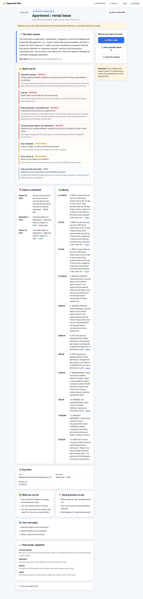
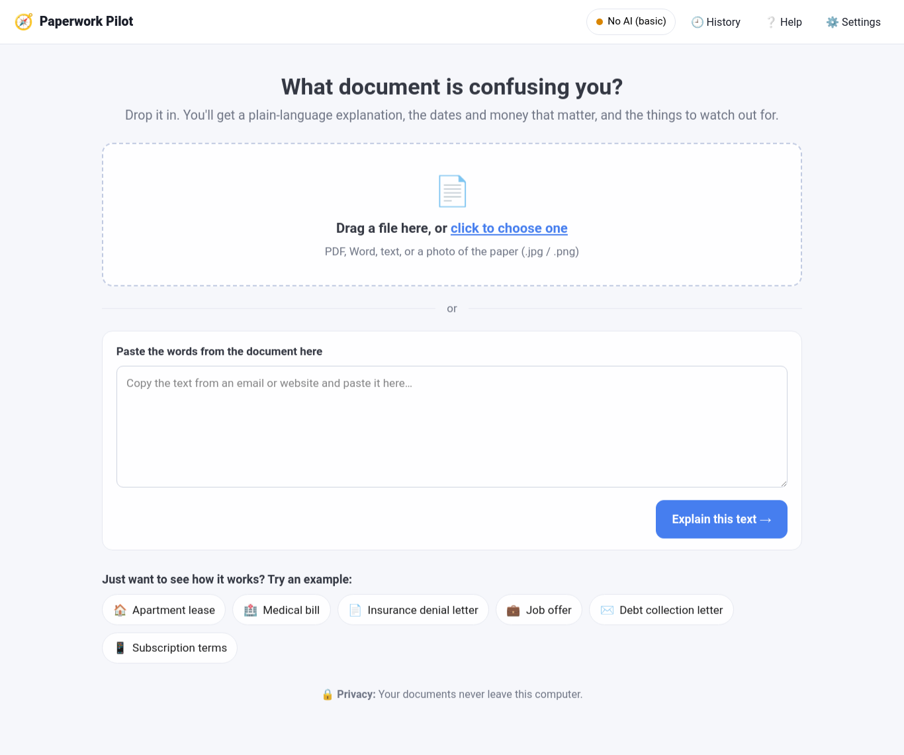

# 🧭 Paperwork Pilot

**Confusing letter? Scary bill? Long lease? Paperwork Pilot explains it in plain words — on your own computer, in private.**

Drop in a lease, medical bill, insurance letter, job offer, debt letter, or any contract. In seconds you get:

- **The short version** — what it is and what it means for you
- **Watch out for** — auto-renewals, late fees, "you can't sue us" clauses, and other gotchas
- **Dates to remember** and **Money** — every deadline and dollar amount, pulled out for you
- **What you can do** and **Good questions to ask**
- **A reply you can edit and send** — dispute a charge, ask for more time, cancel, appeal, or negotiate



> **Private by design.** Your documents never leave your computer unless *you* choose to use a cloud AI key. Works fully offline.

---

## Install (3 steps, about 3 minutes)

Works on Ubuntu, Debian, and most Linux. You need Python 3.10 or newer (most Linux already has it).

**1. Get the code**

```bash
git clone https://github.com/Sockshare/paperwork-pilot.git
cd paperwork-pilot
```

**2. Set up Python (one time)**

```bash
python3 -m venv .venv
source .venv/bin/activate
pip install -r requirements.txt
```

> If `python3 -m venv` complains about *ensurepip*, run `sudo apt install python3-venv` and try again.
> No admin rights? Use this instead of the first line: `python3 -m venv --without-pip .venv && . .venv/bin/activate && curl -sS https://bootstrap.pypa.io/get-pip.py | python`

**3. Start it**

```bash
python app.py
```

Your browser opens to `http://127.0.0.1:8765`. That's it.

Next time, just run `source .venv/bin/activate` and `python app.py`.

---

## First time: pick how the AI runs

The first screen asks one question. Here is how to choose:

| Option | Best for | Cost | Private? |
|---|---|---|---|
| **💻 On my computer** (Ollama) | Most people. Good answers, nothing leaves your PC. | Free | ✅ Yes |
| **☁️ Cloud AI key** (OpenAI / Gemini) | Smartest answers, fastest on older computers. | Usually pennies per document | ❌ Text is sent to that company |
| **🔒 No AI (basic mode)** | Instant. Finds dates, money, and common gotchas with simple rules. | Free | ✅ Yes |

**Want the free, private option?** Install [Ollama](https://ollama.com) (one command) and download a small model:

```bash
curl -fsSL https://ollama.com/install.sh | sh
ollama pull llama3.2:3b
```

Then pick **On my computer** in the app. It runs fine on a normal laptop with no special graphics card — a document takes about 1–4 minutes, and you see the dates, money, and watch-outs instantly while the AI writes the explanation.

You can change your choice any time under **⚙️ Settings**.

---

## How to use it

1. **Add a document.** Drag a file in, click to choose one, or paste the text.
   Works with PDF, Word (.docx), text files, and photos of paper (.jpg/.png — see note below).
2. **Read the cards.** Start with **⚠️ Watch out for**, then **📅 Dates** and **💵 Money**.
3. **Take action.** Click **✍️ Write a reply** for a draft letter or email you can edit, or **💬 Ask a question** about the document. (In basic mode the reply is a fill-in-the-blanks template.)
4. **Print or save** with the **🖨️ Print / Save PDF** button.

Not sure? Click one of the **examples** on the home screen to see it work.



**Photos of paper:** reading photos needs the free Tesseract tool. On Ubuntu/Debian: `sudo apt install tesseract-ocr poppler-utils`. Take the photo straight-on in good light.

---

## Something not working?

Run the setup checker — it tells you exactly what to fix:

```bash
python scripts/selfcheck.py
```

Then see [docs/TROUBLESHOOTING.md](docs/TROUBLESHOOTING.md) for a symptom → fix table.

---

## More help

- [User Guide](docs/USER_GUIDE.md) — every screen and button, with pictures
- [FAQ](docs/FAQ.md) — common questions
- [Privacy](docs/PRIVACY.md) — exactly what goes where in each mode
- [Troubleshooting](docs/TROUBLESHOOTING.md)
- [Architecture](docs/ARCHITECTURE.md) — for developers
- [Quality report](QUALITY.md) — the tests this release passed

---

## Important

Paperwork Pilot is a helper, not a lawyer, doctor, or accountant. It can miss things and small AI models sometimes make mistakes. Always check important dates and amounts against the original, and talk to a professional (many areas have free legal aid) before big decisions.

## License

MIT — free to use, share, and change. See [LICENSE](LICENSE).
