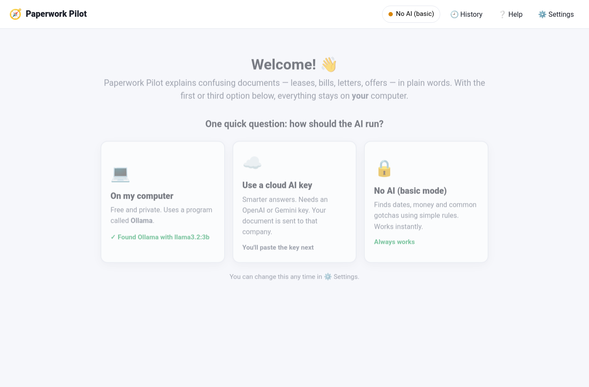
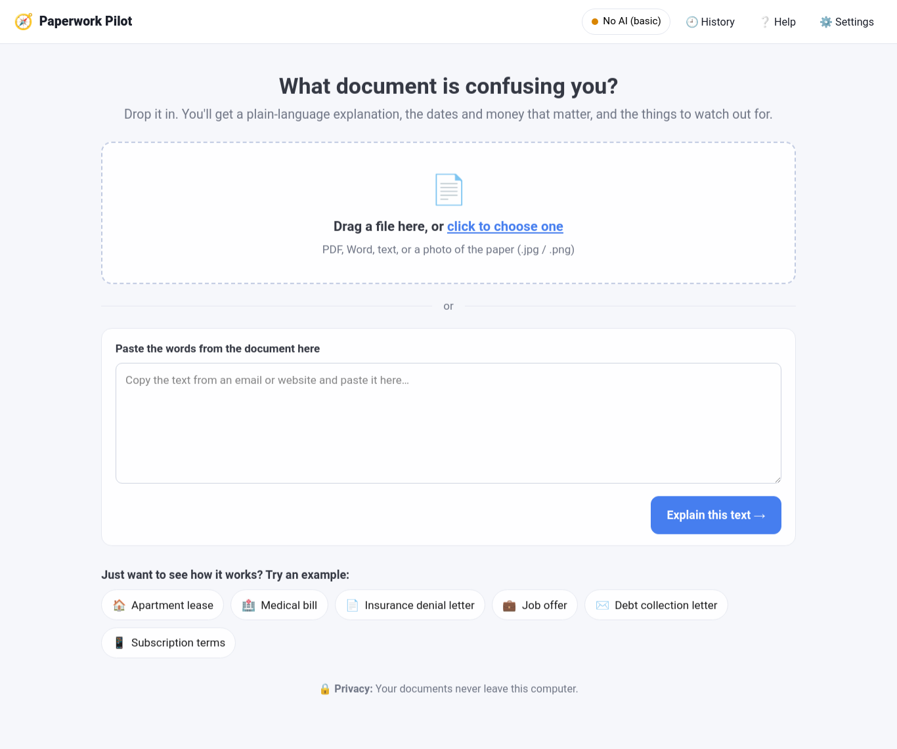
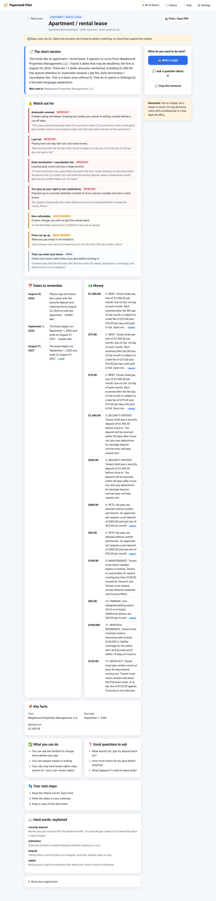
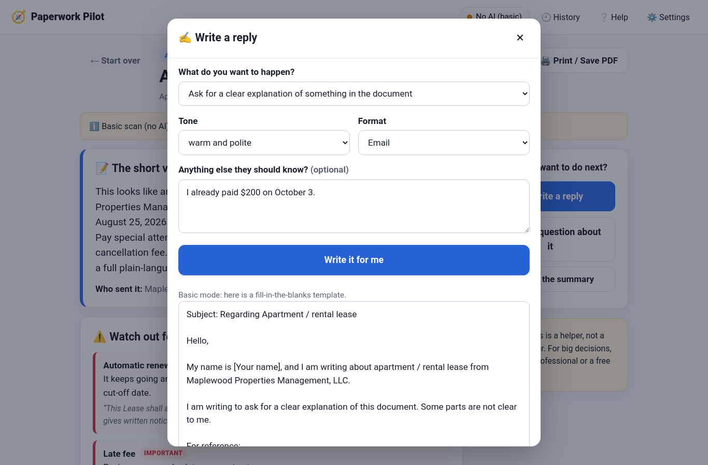
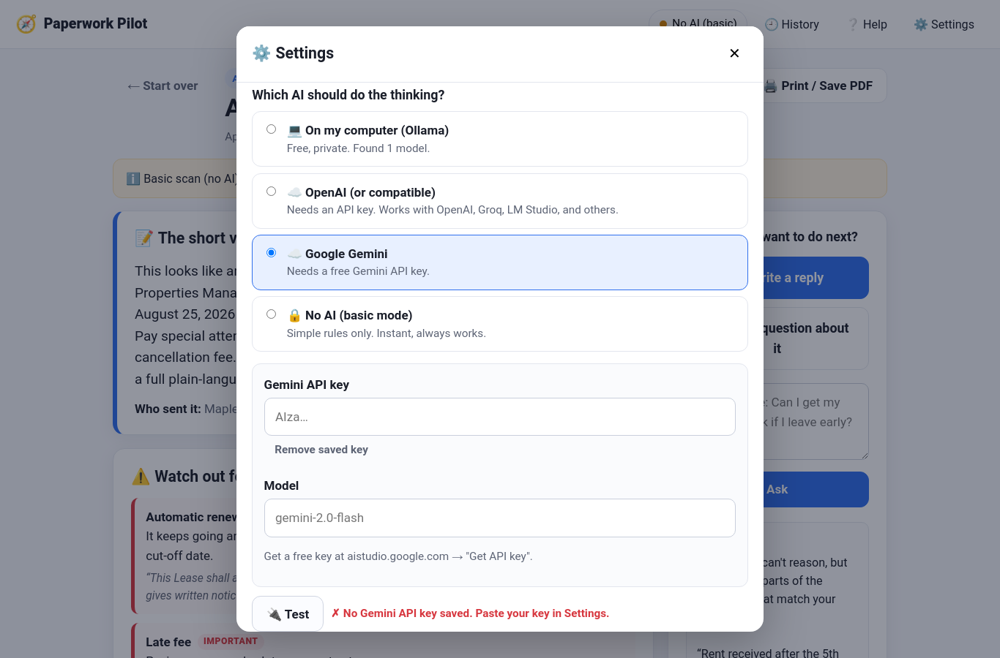

# User Guide

This guide walks through every screen and button. If you only read one thing, read the [Quick tour](#quick-tour).

## Quick tour

1. Start the app: `python app.py`
2. Pick how the AI runs (first time only).
3. Drop in a document, or click an example.
4. Read the cards. Click **Write a reply** or **Ask a question** if you need to act.

---

## Screen 1: Welcome (first time only)

You see three big buttons. Pick one:

- **💻 On my computer** — Uses Ollama, a free program that runs AI on your own PC. The app checks if it's installed and shows a green check if it found it. If not, it shows you the two commands to install it.
- **☁️ Use a cloud AI key** — For OpenAI, Gemini, or similar. You'll paste your key on the next screen.
- **🔒 No AI (basic mode)** — No setup at all. Simple rules find dates, money, and common gotchas.

You can change this later under **⚙️ Settings**. Nothing is permanent.

---

## Screen 2: Home

**The big dotted box** — drag a file onto it, or click it to choose a file. It accepts:

| Type | Works? | Notes |
|---|---|---|
| PDF | ✅ | Scanned PDFs need Tesseract (see [Troubleshooting](TROUBLESHOOTING.md)) |
| Word (.docx) | ✅ | Older .doc files: save as .docx first |
| Text (.txt, .md, .csv) | ✅ | |
| Photos (.jpg, .png, .webp…) | ✅ with Tesseract | Straight-on, good light, fill the frame |

**Paste box** — copy text from an email or website and paste it here, then click **Explain this text**.

**Examples** — six realistic sample documents. Great for seeing how the app works before you use your own.

**Documents you looked at before** — appears once you've analyzed something (if "Remember documents" is on in Settings).

**Top bar**
- The **colored pill** shows which AI is running. Green = ready. Yellow = basic mode. Red = a problem (click it to fix).
- **🕘 History** — everything you've analyzed, with Open and Delete.
- **❔ Help** — a short in-app guide.
- **⚙️ Settings** — change the AI option, keys, and privacy.

---

## Screen 3: Reading your document

A short progress screen with four steps. In basic mode it's instant. With AI, you'll move to the results screen right away and the AI finishes in the background (see the blue banner below).

---

## Screen 4: Results

From the top:

**Title area** — the document type (e.g. "Apartment / rental lease"), a title, and a line showing which engine produced the result and how long it took.

**Blue banner (AI modes only)** — "The AI is reading your document now." The dates, money, and watch-outs are already there from the quick scan. When the AI finishes (about 1–4 minutes on a normal computer, a few seconds with a cloud key), the explanation fills in and the banner disappears. Click **Skip the AI** if you don't want to wait.

**Yellow notes box** — gentle warnings, like "text was read from a photo, double-check the numbers."

**📝 The short version** — a plain-language summary, who sent it, and what they want from you. *(In basic mode this is a short template; the AI modes write a real explanation.)*

**⚠️ Watch out for** — the most important card. Each item has:
- a name (e.g. *Automatic renewal*),
- a tag: **important**, **worth knowing**, or **minor**,
- why it matters in plain words,
- the exact sentence from the document.

**📅 Dates to remember** — every deadline, tagged *soon!*, *coming up*, *later*, or *passed/info*.

**💵 Money** — every dollar amount and what it's for. **repeats** means it's monthly/yearly, not one time.

**📌 Key facts** — the basics at a glance (rent, salary, account number…).

**✅ What you can do** — your options and rights, in plain words. *(Basic mode shows general tips for the document type.)*

**❓ Good questions to ask** — copy these into an email or bring them to a phone call.

**👣 Your next steps** — a short ordered list.

**📖 Hard words, explained** — a mini dictionary for terms that appear in this document.

**Show the original text** — click to see exactly what the app read. Useful for checking.

### Right-side buttons

- **✍️ Write a reply** — opens the reply writer (below).
- **💬 Ask a question about it** — type a question like *"Can I get my deposit back if I leave early?"* Answers use only the document. In basic mode it shows the matching sentences instead.
- **📋 Copy the summary** — copies a clean text version to paste anywhere.
- **🖨️ Print / Save PDF** (top right) — the page is formatted for printing.
- **← Start over** — back to the home screen.

---

## The reply writer

1. **What do you want to happen?** — pick a goal (dispute a charge, ask for more time, cancel, appeal, request a payment plan, negotiate, ask a question, validate a debt, confirm in writing, request repairs). The app pre-selects a sensible one for the document type.
2. **Tone** — polite, firm, or formal.
3. **Format** — email or printed letter.
4. **Anything else they should know?** — optional. Facts you want included ("I already paid $200 on October 3").
5. Click **Write it for me**.

The letter appears in a box you can edit. Anything in **[square brackets]** is for you to fill in. Then **Copy**, **Download**, or **Try again**.

In basic mode (or if the AI fails) you get a solid fill-in-the-blanks template instead.

---

## Settings

**Which AI should do the thinking?** — the same three choices as the welcome screen, plus Gemini as a separate option.

- **Ollama:** choose a model from the list (the app shows what you've downloaded) and click **Test**.
- **OpenAI or compatible:** paste your key. The *server address* also works with Groq, Together, LM Studio, or any OpenAI-style server.
- **Gemini:** paste a key from aistudio.google.com.

**🔌 Test** — checks the connection without saving. Always do this after pasting a key.

**Privacy**
- **Remember documents I analyze** — on by default. Everything is saved in a small file in your home folder (`~/.paperwork_pilot/history.db`). Turn it off and nothing is kept.
- **🗑️ Delete all saved documents** — one click, gone.

Click **Save settings** when done.

---

## Keyboard shortcuts

- **Esc** closes any pop-up.
- **Ctrl+Enter** in the question box sends the question.
- **Enter** or **Space** on the dotted box opens the file picker.

---

## Tips for the best results

- **Paste text when you can.** It's always cleaner than a photo.
- **Photos:** flat, straight, bright, no shadows. One page per photo.
- **Long documents** (20+ pages) take longer with local AI. The quick scan is still instant.
- **Check the numbers.** Small AI models are good but not perfect. The "Show the original text" link makes checking easy.
